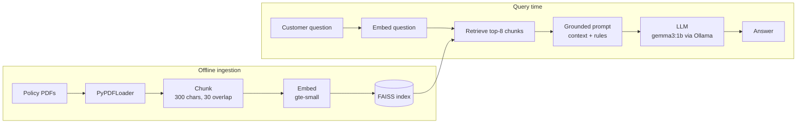

# RAG Customer Support Chatbot

A retrieval-augmented generation (RAG) chatbot that answers customer questions for a fictional outdoor-gear store, **Everstorm Outfitters**, using only the store's policy documents (shipping, returns, payments, sizing). It runs fully locally: open-source embeddings, a FAISS vector index, and a small LLM served by Ollama, with a Streamlit chat UI.

**Stack:** Python · LangChain · FAISS · Hugging Face embeddings (`gte-small`) · Ollama (`gemma3:1b`) · Streamlit · evaluated against gpt-oss-20B/120B via Groq

## Architecture



## How it works

1. **Ingest:** load 4 policy PDFs (8 pages) and split them into 42 overlapping chunks.
2. **Index:** embed each chunk with `thenlper/gte-small` and store the vectors in a FAISS index saved to disk.
3. **Retrieve:** embed the user's question and fetch the 8 most similar chunks.
4. **Generate:** put the retrieved text into a prompt that tells the model to answer *only* from that context and to say it doesn't know otherwise.
5. **Serve:** a Streamlit chat UI loads the saved index once (`st.cache_resource`) and keeps conversation history in session state.

## Design decisions

| Decision | Why | Trade-off |
|---|---|---|
| **Fully local stack** (gte-small + Ollama) | No API keys or per-query cost, and customer questions never leave the machine | Small local models are less accurate than hosted frontier models (see Evaluation) |
| **`gte-small` embeddings** (77M params) | Fast on CPU and strong retrieval quality for its size | Lower recall than larger embedding models on nuanced queries |
| **FAISS, persisted to disk** | Simple in-process vector search; the index is built once and reloaded by the app | No metadata filtering or incremental updates like a vector database server would offer |
| **Small chunks (300 chars, 30 overlap)** | Policy documents are dense with short, specific rules; small chunks keep retrieval precise | A rule split across chunks can lose context, so the overlap preserves continuity |
| **k = 8 retrieved chunks** | Policies spread related rules across sections; a wider net improves the chance the right rule is in context | More context means more opportunity for a small model to mix up rules |
| **Explicit retrieve → format → prompt → invoke** pipeline (not a prebuilt chain) | Each step can be inspected and debugged on its own | Slightly more code than a one-line chain |
| **Low temperature (0.1)** | Customer support needs consistent, factual answers, not creativity | Less varied phrasing |

## Evaluation: is it retrieval or the model?

During testing, the bot told a customer that *"Final Sale" and custom-embroidered items are eligible for a refund*. The policy says the opposite: **"no return unless defective."** To find out whether the search step or the language model was at fault, I built a small evaluation harness ([`eval/`](eval/)).

**Method**
- 10 questions with answers verified against the policy PDFs, including one the documents don't answer (price matching), to test whether the bot admits it doesn't know.
- **Retrieval check:** for each question, confirm that the passage containing the correct answer is among the 8 retrieved chunks.
- **Answer check:** required and forbidden phrases per question, with every answer also reviewed by hand.
- **Only the generator model changes.** Embeddings, index, k, prompt, and temperature stay identical.

**Results**

| Generator | Size | Correct (of 10) | Retrieval found the answer |
|---|---|---|---|
| `gemma3:1b` (local, Ollama) | 1B | **2** | 9 / 9 |
| `gpt-oss-20b` (Groq) | 20B | **9** | 9 / 9 |
| `gpt-oss-120b` (Groq) | 120B | **9** | 9 / 9 |

**What this shows**
- **Retrieval was never the bottleneck.** The correct passage was in the context for every answerable question, yet the 1B model got 7 of 9 wrong or said it didn't know.
- **The small model fails in risky ways.** It reversed rules (it told a gift-giver they would get a refund, when gifts return as store credit to the recipient), gave the West Coast delivery time for the East Coast, and said "I'm not sure" about crypto payments and warranties even when the answer was in the context.
- **20B is the sweet spot here.** It matched 120B on every question, so for this workload the smaller hosted model gives the same accuracy at lower cost and latency.
- **The remaining miss is shared.** Both large models gave the 30-day window but left out some return conditions ("tags attached"). Because both made it, prompt or chunking changes are a better fix than a bigger model.

```bash
python eval/evaluate.py --model gemma3:1b --base-url http://localhost:11434/v1
GROQ_API_KEY=... python eval/evaluate.py --model openai/gpt-oss-20b \
    --base-url https://api.groq.com/openai/v1 --api-key-env GROQ_API_KEY
```
Raw answers for each model are saved in [`eval/results/`](eval/results/).

## What I'd improve next

- **Switch the default generator** to a ~20B model (hosted, or local on a machine with enough memory). The evaluation shows this is the single biggest accuracy gain.
- **Run the evaluation in CI** so prompt or model changes can't silently reintroduce wrong answers.
- **Rerank** the top-k results so fewer, more relevant chunks reach the model.
- **Cite sources in answers.** The prompt asks for citations, but the chunks are passed without their source metadata.
- **Simplify the prompt.** It currently gives two different "I don't know" phrasings; one clear fallback is easier for a small model to follow.

## Run it

```bash
# 1. Environment
conda env create -f environment.yaml && conda activate rag_chatbot
#    or: uv venv && source .venv/bin/activate && uv pip install -r requirements.txt

# 2. Local LLM
brew install ollama        # or see https://ollama.com/download
ollama serve               # keep running
ollama pull gemma3:1b

# 3. Build the vector index
python ingest.py

# 4. Chat
streamlit run app.py
```

`rag_chatbot.ipynb` walks through each step with outputs, including the optional web-page ingestion with an offline fallback.
