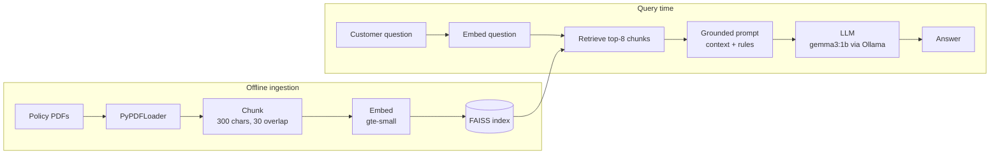

# RAG Customer Support Chatbot

A retrieval-augmented generation (RAG) chatbot that answers customer questions for a fictional outdoor-gear store, **Everstorm Outfitters**, using only the store's policy documents (shipping, returns, payments, sizing). It runs fully locally: open-source embeddings, a FAISS vector index, and a small LLM served by Ollama, with a Streamlit chat UI.

**Stack:** Python · LangChain · FAISS · Hugging Face embeddings (`gte-small`) · Ollama (`gemma3:1b`) · Streamlit

## Architecture



## How it works

1. **Ingest:** load 4 policy PDFs (8 pages) and split them into 42 overlapping chunks.
2. **Index:** embed each chunk with `thenlper/gte-small` and store the vectors in a FAISS index saved to disk.
3. **Retrieve:** embed the user's question and fetch the 8 most similar chunks.
4. **Generate:** put the retrieved text into a prompt that tells the model to answer *only* from that context and to say it doesn't know otherwise.
5. **Serve:** a Streamlit chat UI loads the saved index once (`st.cache_resource`) and keeps conversation history in session state.

## Design decisions

| Decision | Why | Trade-off |
|---|---|---|
| **Fully local stack** (gte-small + Ollama) | No API keys or per-query cost, and customer questions never leave the machine | Small local models are less accurate than hosted frontier models (see Limitations) |
| **`gte-small` embeddings** (77M params) | Fast on CPU and strong retrieval quality for its size | Lower recall than larger embedding models on nuanced queries |
| **FAISS, persisted to disk** | Simple in-process vector search; the index is built once and reloaded by the app | No metadata filtering or incremental updates like a vector database server would offer |
| **Small chunks (300 chars, 30 overlap)** | Policy documents are dense with short, specific rules; small chunks keep retrieval precise | A rule split across chunks can lose context, so the overlap preserves continuity |
| **k = 8 retrieved chunks** | Policies spread related rules across sections; a wider net improves the chance the right rule is in context | More context means more opportunity for a small model to mix up rules |
| **Explicit retrieve → format → prompt → invoke** pipeline (not a prebuilt chain) | Each step can be inspected and debugged on its own | Slightly more code than a one-line chain |
| **Low temperature (0.1)** | Customer support needs consistent, factual answers, not creativity | Less varied phrasing |

## Limitations and what I'd improve

Testing showed a real failure mode. Asked about refunds, the bot answered that *"Final Sale" and custom-embroidered items are eligible for a refund*, but the policy says the opposite: **"no return unless defective."** It also misstated the holiday return window. Retrieval found the right chunk; the 1B-parameter model then misread it.

To make this production-ready, I would:
- **Add an evaluation set:** questions with known answers from the policies, scored automatically for correctness and grounding, so regressions like this are caught.
- **Use a stronger generator** (for example, a 7B+ model or a hosted LLM) and compare accuracy against cost.
- **Rerank** the top-k results so fewer, more relevant chunks reach the model.
- **Cite sources in answers.** The prompt asks for citations, but the chunks are passed without their source metadata.
- **Simplify the prompt.** It currently gives two different "I don't know" phrasings; one clear fallback is easier for a small model to follow.

## Run it

```bash
# 1. Environment
conda env create -f environment.yaml && conda activate rag_chatbot
#    or: uv venv && source .venv/bin/activate && uv pip install -r requirements.txt

# 2. Local LLM
brew install ollama        # or see https://ollama.com/download
ollama serve               # keep running
ollama pull gemma3:1b

# 3. Build the vector index
python ingest.py

# 4. Chat
streamlit run app.py
```

`rag_chatbot.ipynb` walks through each step with outputs, including the optional web-page ingestion with an offline fallback.
